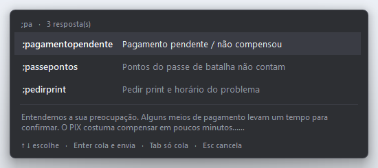
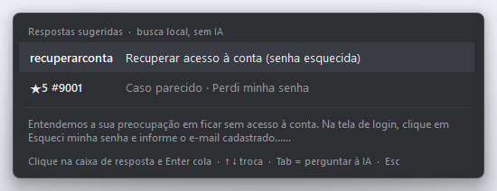
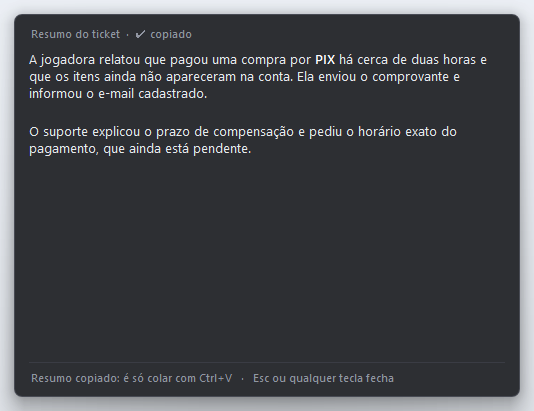
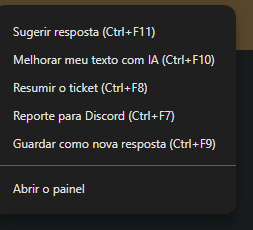

# Painel de Suporte

Ferramenta para Windows que **acelera o atendimento de tickets de suporte** de um jogo online: você digita um atalho
em qualquer caixa de texto e a resposta pronta aparece, e uma IA ajuda a achar, melhorar e resumir respostas.

> **Esta é a edição de demonstração.** As 16 respostas e os 9 tickets de exemplo são **fictícios** (um jogo inventado,
> "Reino de Aurora"). Não há dados reais de jogadores, empresas ou sistemas neste repositório.



## A ideia

Quem trabalha com suporte responde às mesmas dúvidas dezenas de vezes por dia: senha esquecida, pagamento pendente,
morte por lag, pedido de reembolso. O trabalho repetitivo é copiar a resposta certa, colar no ticket e ajustar.
Este projeto ataca três pontos:

1. **Achar a resposta rápido.** Uma biblioteca de respostas com busca e um *expansor global*: em qualquer programa
   (navegador, chat), digitar `;pag` abre uma lista, e Enter cola a resposta formatada e envia.
2. **Escolher a resposta certa quando você não lembra o atalho.** Você seleciona a mensagem do jogador, aperta
   `Ctrl+F11`, e o programa sugere as respostas mais adequadas, incluindo casos parecidos que já foram resolvidos.
3. **Escrever menos.** Para o que não tem resposta pronta, a IA melhora o seu rascunho (`Ctrl+F10`) ou resume o ticket (`Ctrl+F8`).

Tudo isso também está no **menu do botão direito do Chrome**, por uma extensão que acompanha o projeto.



## O que ele faz

| Atalho | Função |
|---|---|
| `;atalho` em qualquer caixa de texto | Abre a lista de respostas; **Enter** cola e envia, **Tab** só cola |
| `Ctrl+F11` | Lê a mensagem do jogador selecionada e sugere a resposta certa (busca local primeiro; IA só se precisar) |
| `Ctrl+F10` | Melhora o texto selecionado com IA, seguindo o estilo das respostas do acervo; mostra uma prévia perto do cursor |
| `Ctrl+F8` | Resume o ticket em texto corrido e copia o resumo |
| `Ctrl+F7` | Monta o reporte de bug para o Discord da equipe (`Ticket` / `Jogador` + mensagem original) e copia; **Tab** troca para uma versão resumida pela IA |
| `Ctrl+F9` | Guarda o texto escrito no ticket como uma nova resposta pronta |
| Botão direito no Chrome | As mesmas funções pelo menu do navegador (extensão em `extensao_chrome/`) |

Quando a mensagem do jogador fala em bug ("não funciona", "travou", "deu erro"), o `Ctrl+F11` sempre inclui a resposta
que pede print ou vídeo (`;pedirprint`) entre as opções.

Também tem: ícone na bandeja, painel de busca, lista de atalhos em HTML (com busca), contador de usos (as respostas
mais usadas aparecem primeiro) e relatório das buscas sem resultado, para saber que resposta está faltando.

### Casos reais parecidos

O programa pode consultar um arquivo de **tickets já respondidos** (aqui, `tickets_exemplo.json`, fictício) e buscar os
mais parecidos com a mensagem do jogador. Respostas bem avaliadas pelo jogador pesam mais. Isso acontece **localmente, sem
gastar IA**, e, quando o caso é muito parecido, ele aparece direto como sugestão. As respostas que você aprova e cola
também entram nesse acervo e sobem na lista nas próximas buscas.



### Menu do botão direito no Chrome



A pasta `extensao_chrome/` tem uma extensão que coloca as funções no menu do botão direito: **Sugerir resposta**,
**Melhorar meu texto com IA**, **Resumir o ticket**, **Reporte para Discord**, **Guardar como nova resposta** e
**Abrir o painel**. Cada opção faz exatamente o mesmo que o atalho de teclado correspondente.

A extensão também serve de **ponte** entre o programa e a página do ticket: em vez de simular `Ctrl+C`/`Ctrl+V`, o
programa pede à extensão para ler a seleção (ou a página) e para colar a resposta direto na caixa do ticket, com
negrito e parágrafos. Isso resolve um problema real: o anti-cheat do cliente do jogo, quando aberto, bloqueia teclas
simuladas no Windows inteiro, e a colagem automática parava de funcionar. Se a extensão não responder, o programa
volta sozinho ao teclado e deixa o texto copiado para um `Ctrl+V` manual.

Para instalar:

1. Abra `chrome://extensions` e ligue o **Modo do desenvolvedor**.
2. Clique em **Carregar sem compactação** e escolha a pasta `extensao_chrome`.
3. Em `manifest.json`, troque `https://tickets.exemplo.com/*` pelo endereço do seu sistema de tickets (é onde a ponte
   pode ler e colar).

## Como rodar

Requisitos: **Windows 10/11** e **Python 3.9+** (com Tkinter, que já vem no instalador oficial).

```bash
python painel_suporte.py
```

Na primeira execução ele instala sozinho as dependências (`keyboard`, `pystray`, `pillow`). Para abrir sem janela
preta, use `iniciar_painel.vbs`. Para ver mensagens de erro, use `iniciar_painel_diagnostico.bat`.

Outros modos: `--listar` (lista os atalhos), `--sem-expansor`, `--minimizado`, `--lista` (abre a lista de atalhos no
navegador), `--teclas` (diagnóstico do teclado).

### IA (opcional)

Os recursos de IA usam a API do **Google Gemini**, que tem camada gratuita. Crie uma chave em
[aistudio.google.com](https://aistudio.google.com) e coloque em `dados/config_painel.json` (criado na primeira execução):

```json
{ "gemini_api_key": "SUA_CHAVE_AQUI" }
```

Sem a chave, tudo continua funcionando, exceto `Ctrl+F10`, `Ctrl+F8`, o resumo do `Ctrl+F7` e a parte de IA do `Ctrl+F11`.
Antes de enviar um texto à IA, e-mails e números longos são trocados por marcadores e restaurados depois.

## Como usar com as suas respostas

- Edite a lista `RESPOSTAS_PADRAO` em `painel_suporte.py`, ou
- Escreva a resposta no ticket e aperte `Ctrl+F9`: ela é guardada em `dados/respostas_custom_painel.json`.

Cada resposta tem `atalho`, `palavras_chave`, `categoria`, `titulo` e `resposta`. Regras de formato seguidas pelas
respostas de exemplo: parágrafos separados por linha em branco, passos numerados só em procedimentos e `**negrito**`
em poucos trechos-chave. Ao colar, o texto vai também como **HTML** (`<p>`, `<strong>`), para o editor do ticket
preservar parágrafos e negrito.

## Decisões técnicas

- **Hook global de teclado** (`keyboard`) com `suppress=True`: o callback precisa devolver `True`/`False` explícito, e as
  teclas que o próprio programa envia são ignoradas por uma flag. O programa também espera soltar Ctrl/Shift/Alt antes de
  enviar teclas, para não disparar atalhos do navegador sem querer.
- **Tkinter não é thread-safe:** o hook e as chamadas de IA rodam em threads e mandam mensagens por uma fila, que a thread
  da interface consome.
- **Área de transferência via Win32 (`ctypes`)**, com texto simples e `HTML Format`, para colar com formatação.
- **Caixinhas sem foco** (`WS_EX_NOACTIVATE`): aparecem perto do cursor sem roubar o foco do ticket; no Windows 11 usam
  cantos arredondados, borda e sombra do DWM, e transparência configurável (`popup_opacidade`).
- **Busca de casos parecidos** por palavras raras (idf), com bônus para assuntos-chave, nota do jogador e uso anterior.
- **IA resiliente:** vários modelos em ordem de preferência, pausa automática de um modelo quando a cota gratuita acaba
  (429) ou quando ele está sobrecarregado (503), e nova tentativa.
- **Ponte local com a extensão:** o programa abre um servidor HTTP só em `127.0.0.1`, que exige um cabeçalho próprio e
  recusa qualquer `Origin` que não seja `chrome-extension://`, para nenhuma página da internet conseguir acioná-lo. Um
  documento *offscreen* da extensão fica em *long-poll* esperando pedidos (`ler` ou `colar`), e cada pedido leva um prazo:
  a página não age atrasada, para nunca colar duas vezes.
- **Colagem por evento `paste` sintético** (`DataTransfer` com texto e HTML): o editor do ticket (ProseMirror) trata o
  evento como uma colagem real e mantém negrito e linhas em branco. Antes de colar, a extensão confere que o `;atalho`
  digitado está mesmo antes do cursor.
- **Nenhum erro fecha o programa em silêncio:** tudo é registrado em `dados/erro_painel.log`.

## Estrutura

```
painel_suporte.py          # o programa (arquivo único; procure os banners "# ====")
tickets_exemplo.json       # tickets fictícios de exemplo (formato usado na busca de casos)
extensao_chrome/           # extensão do Chrome: menu do botão direito + ponte para ler/colar no ticket
iniciar_painel.vbs         # abre sem janela preta
iniciar_painel.bat
iniciar_painel_diagnostico.bat
docs/                      # imagens deste README
```

Pastas criadas ao usar (não vão para o repositório, estão no `.gitignore`): `dados/` (`config_painel.json`,
`usos_painel.json`, `respostas_custom_painel.json`, `casos_aprendidos_painel.json`, `erro_painel.log`) e
`relatorios/` (`buscas_sem_resultado.csv`, `lista_atalhos.html`).

## Testes

As funções que não dependem do Windows (busca de respostas, anonimização, conversão para HTML, leitura do ticket, reporte de bug) têm testes automáticos, rodados no GitHub Actions a cada push:

```bash
pip install pytest
python -m pytest -q
```

## Estado do projeto

Projeto pessoal, em evolução. Desenvolvido e testado no **Windows 11**; no Windows 10 as caixinhas ficam com cantos
retos. Este repositório mostra o funcionamento com conteúdo fictício e **não inclui** nenhuma integração com sistemas
de tickets reais.

## Aviso

Este código é apenas de **demonstração** e **não contém dados reais**: as respostas e os tickets são fictícios.
Todos os direitos reservados a **Matheus Lencione**. Não é permitido copiar, modificar ou redistribuir sem autorização.
